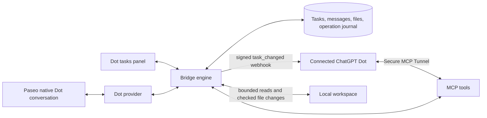

# Paseo Dot Bridge

Chat with your connected ChatGPT **Dot** in Paseo and apply requested code changes directly to the **local workspace**. Text, progress, files and code edits travel through MCP. Git delivery has been removed.

Plugin ID: `paseo-dot-bridge`. Select **Dot → Connected Dot** in a normal Paseo conversation, or create a request in **Dot tasks**. Both use the same durable task engine. There is no repository, remote, branch or commit setup.

## Conversation and local code changes

- Dot reads the latest task and prior rounds, claims the current round, and replies through the Bridge. Longer work starts with a short acknowledgment and useful progress messages in the chat. The complete answer finishes the turn. Delivery is incremental messages, not token streaming.
- Native conversations show Bridge activity as Dot's calls finish: reading your message, listing directories, reading files/attachments, file-edit diffs and chunked attachment progress. Progress updates reuse one card; file conflicts and refused calls show failures. The provider checks for updates every 750 ms. No new Dot tools or subscription instructions are needed for this display; reload the updated plugin to enable it.
- A code request uses `list_dot_files`, `read_dot_file` and `apply_dot_changes`. These operate on the workspace bound by Paseo, including uncommitted files. A code example or attached file alone does not change the workspace.
- Reviewing current edits uses the read-only `read_dot_workspace_changes` tool. It returns staged/unstaged diffs and new-file text in pages of 20 files. Pass `snapshotId` with every `nextOffset`; if files, index objects or HEAD change, restart from offset 0 without a snapshot ID. Continue `nextDiffs` using `snapshotId`, `path`, `diffKind` and its byte `diffOffset` plus `sha256` as `diffSha256` at offset 0. A single-file continuation has a fresh output budget, so a large diff can be read completely. Snapshot validation is bounded to 5,000 source paths and does not lock external editors; editing still requires a fresh `read_dot_file` hash. A scoped read grant is applied before scanning or reading any source/blob; `scopeLimited` means only those exact authorized files were inspected. Patches are built from captured HEAD/index objects and file bytes, independently of Git diff configuration; continuation fingerprints reject mismatched patches. Protected paths stay excluded. Binary/unsafe/oversized files, unresolved conflicts, sparse-checkout absence and cross-workspace rename baselines remain explicit. Present `assume-unchanged`/`skip-worktree` files are compared as raw source bytes without changing their Git flags. Zero detected changes is about disk/index state, not unsaved editor buffers or committed branch changes. `task.localChanges` contains only Dot write receipts. Remote reviews execute on the originating device and check task state, expiry, capability and read scope again before delivery. Exact write retries recover already-recorded outcomes even after approval consumption or a round stop; changed payloads still require fresh approval. Reload the plugin and refresh its connected tools in ChatGPT after upgrading.
- Before replacing or deleting a file, Dot reads its current SHA-256. Every change includes that expected hash; a new file uses `null` and is created only if absent. The latest user-message sequence must also match. Known conflicts are rejected before the batch starts, and each file is checked again immediately before mutation.
- Changes apply automatically within the user's request. The returned receipt lists exactly which files were created, updated or deleted. The chat and task panel show the outcome. New permissions and unrelated or destructive actions still require asking the user.
- Files are UTF-8 text, at most **256 KiB each**; a call contains **1–32 files**, up to **1 MiB** of replacement content. Full file contents are submitted, rather than a Git patch. Directory listing is paginated in groups of 200. Binary files still use attachments rather than local edits.
- Relative paths only. Parent traversal, symlinks below the workspace, hardlinked files, Git internals and common credential paths are refused. File modes and untouched files are preserved. No shell commands or local tests are executed by these tools.

The original contents and exact outcome are retained in a private durable operation journal. Replaying the same operation and payload returns its original receipt, even if a user edits a file afterward; changed-content replays are rejected. A crash during a batch does not cause remaining files to be blindly written on retry. An unexpected mid-batch failure reports `partial` with the applied subset; it is not reported as a successful full change. There is no automatic rollback or one-click undo in this version.

When ChatGPT ends an `apply_dot_changes` call without a Bridge response (for example `user cancelled MCP tool call`), Dot replays the same operation ID only while it still holds the identical payload. A Dot run woken by a later event may not have it. It then reads the task: a receipt in `localChanges` is the outcome. Without one, Dot re-reads the affected files and rebuilds the requested change from their current content under a new operation ID, leaving out anything already present, instead of waiting for a payload it cannot recover. Hash checks refuse the rebuild if a file changes after that read, including a late landing of the earlier call. An operation-bound Paseo permission cannot cover a new operation ID or changed bytes; guarded access requires a fresh scoped approval for the rebuilt change. This rule is sent with every `get_dot_task`, so existing conversations use it after the plugin reloads; the shorter `apply_dot_changes` description changes after refreshing the plugin's tools in ChatGPT.

The Bridge serializes its own writes. It cannot lock every external editor or process: the final filesystem check and rename/unlink are not an OS-level multi-file transaction. Avoid concurrently editing the same file while Dot applies a change. Routine stale-content conflicts are detected; failures and interrupted operations remain visible with backups in the journal.

Activity shows operations that pass through the Bridge. Dot's own text still arrives through progress/final-answer calls. Read/list/upload activity keeps the latest 200 cards per task in the plugin process; a process restart does not replay that transient history. Edit cards replay from durable receipts and the original change journal, even after later user edits. Large rewrites or missing/invalid journals show the file path without a diff. See [Paseo permission validation](docs/permission-validation.md), [activity feed validation](docs/activity-feed-validation.md) for coverage and limits.

## Architecture



The plugin registers the provider in Paseo; it does not run a Dot CLI or forward arbitrary workspace tools. One conversation maps to one task. Follow-ups open another round after completion; answers to Dot's questions continue the current round. Persistence replays messages, results and files and reattaches to active work without dispatching another task. Closing a conversation detaches the local view. Stopping a queued or unclaimed task cancels it locally and releases its slot; a late claim is refused. Claimed work keeps its slot until Dot acknowledges the stop, and further local file operations are blocked. Startup also finishes old recorded stop requests for unclaimed tasks, so they cannot leave new conversations queued indefinitely. Stop requests do not undo files already applied.

If claimed work no longer responds after a stop request, use **Dot tasks → task details → Close round locally**. This explicitly releases its slot and prevents further workspace access or uploads from that round. It does **not** assert that remote work or external tools stopped: the UI preserves that distinction until Dot acknowledges. Late results remain historical and cannot complete or revive the locally closed round. Retry or send a new message to open a fresh round; late calls from the old round cannot mutate it.

## Setup

```bash
paseo plugin add git:lalaze/paseo-plugins --path dot-bridge
```

This Git URL is an **installation source**, not a task delivery channel. `install-all.sh` and `update-all.sh` do not install or update this plugin.

1. Enable the plugin on the host. In **Settings → Dot Bridge**, configure the listening address/port and in-flight cap (1 or 2).
2. In **Dot tasks → Connection**, configure the connection name and public tunnel base. Use a Secure MCP Tunnel to the plugin's separate `/mcp/dot` server, not Paseo's `/mcp/agents` endpoint.
3. Connect the custom plugin in ChatGPT and copy the current connection instructions to Dot. It must subscribe to `paseo.dot.task_changed` and `paseo.dot.connection_test`, using the platform callback and signing secret.
4. Run the two-way connection test. Dispatch waits for the local service, verified event route and successful Dot challenge response.
5. After upgrading, refresh the connected plugin's tools in ChatGPT. The old `submit_dot_result` is removed; the local file tools and attachment chunk tools must be visible. Update existing subscription instructions to use local edits, not cloud Git delivery. Only requests from the selected workspace authorize relevant file changes; new permissions still require confirmation.

Temporary listen failures (such as an occupied port) appear in connection status and retry automatically with a 2.5–30 second backoff. Settings changes trigger a new bind without waiting for that backoff; concurrent checks share the same start operation.

A subscription originally limited to observing a connection test can receive events without executing them. Its task-handling instructions must permit processing the user's requests. The user's existing connection was previously enabled for native conversations; the current local-edit validation record states whether the upgraded tools and rules have been verified live.

Callback delivery supports Clash/Mihomo's `198.18.0.0/15` fake-IP mappings for the exact `connectors.api.openai.com` host on HTTPS port 443, without changing the proxy configuration. The connection stays pinned to the checked address, with the original hostname used for TLS certificate verification and subscription challenges. Other callbacks and actual local/private addresses remain blocked. Events previously blocked before sending by the address check are rechecked automatically and delivered with their original event IDs once allowed; completed deliveries and permanent HTTP failures are not replayed.

## Attachments

Dot returns files directly through the Bridge, without asking the user to open ChatGPT Library or download an attachment there. Each delivered file is automatically saved on the **Paseo host** as `files/<taskId>/<operationId>/<name>` in the plugin data directory, with a path shown in the conversation. Files are separate from the project and never overwrite another operation's file. Saving on the host does not copy the file to a remote phone.

`upload_dot_attachment` still handles files up to **1 MiB**. Larger files use `upload_dot_attachment_chunk`: **20 MiB per file, 16 attachments per conversation**, 393216 raw bytes per chunk (the final chunk may be smaller). All chunks share an operation UUID, filename, MIME type, total size and full-file SHA-256. Each chunk is Base64 encoded; this is chunked MCP transport, not an unauthenticated HTTPS download URL. The response lists received indices; the last required chunk verifies the complete file and returns `complete: true` with the saved attachment. Exact retries and out-of-order delivery work across process restarts. Changed manifests/bytes, stale rounds, unclaimed tasks and stop requests are rejected. Incomplete transfers are bounded to 16 per task; expired transfers are cleaned when that task next uploads after 24 hours. Completed blobs and delivered files are retained without automatic pruning.

Use `read_dot_attachment_chunk` to read larger files. PNG/JPEG/WebP/GIF attachments preview in the conversation; images up to 8 MiB load automatically, larger ones have a preview button to bound memory use. SVG/HTML attachments are never rendered as active content. The web client can save another copy; native clients can copy the host path or small UTF-8 attachments. User-initiated uploads remain limited to 1 MiB. Existing attachments remain readable; only newly delivered Dot files receive named local copies.

## Authorization included in future prompts

**Settings → Dot Bridge → Task authorization** lets the host user opt in to automatically
appending a scoped authorization note to new native prompts, task-panel requests and follow-ups.
It is off by default. The note identifies the bound workspace and permits relevant file reads and
returning the needed contents to the connected Your dot / ChatGPT for the current request. File
edits are permitted only when the actual user request asks for them. Explicit restrictions, denials
and cancellations still apply; unrelated work, secrets, security changes, network exposure,
credentials, publishing and Git commits/pushes remain excluded.

The note is saved with each new user message, so retries do not duplicate it and changing the setting
does not rewrite history. It never creates an approved permission record or claims platform approval.
Already-blocked tool calls are not retried by enabling it. If the appended note would exceed the
20,000-character message limit, submission fails with an explanation instead of truncating input.
Tasks without a workspace binding and historical Git tasks do not receive workspace authorization.

## Follow-ups while Dot is working

The native provider supports `prompt.steer`: a new message during an active turn is appended to
that same Bridge round and announces the latest input to Dot. It retains the native turn ID;
retries with the same client message ID do not append duplicate messages. Reconnecting to an
active task also accepts an ordinary follow-up as steering rather than starting duplicate work.
The current round is checked again when the message is saved, so a concurrent stop or completion
rejects the steer instead of creating another round. A new message invalidates an older pending
permission request; it never approves that request automatically.

After a permission decision or answer, the status card says it is waiting for **Dot to continue**,
rather than asking the user to answer again. This does not remove remote event-processing latency
or grant ChatGPT platform approval. Reload the plugin while native Dot sessions are idle; reloading
an active provider still disconnects its local session.

## Confirmations inside Paseo

When additional authorization is needed, Dot calls `request_dot_permission` with the current
round/message sequence, a stable request UUID, the reason, tool name, action and exact targets.
Paseo displays native **Allow this operation / Deny** controls; the same request is also available
in **Dot tasks** details. Either choice is saved atomically with a scoped user message and a wake-up
event. Dot must read the latest task before continuing. There is deliberately no MCP approval tool.

Pending requests survive reconnects/restarts. Stop, new user instructions or a finished round expire
pending buttons. Duplicate decisions do not duplicate messages; conflicting decisions are refused.
Pending, denied and platform-blocked current requests block Bridge file writes/uploads. Mutation
approvals bind the tool, exact targets, operation UUID and content. For `apply_dot_changes`, include
`scope.operation: {kind: "files", operationId, changes: [{path, expectedSha256, contentSha256}]}`.
`contentSha256` is the SHA-256 of the exact replacement UTF-8 bytes, or `null` for deletion; the
expected hash is `null` only when creating a file. Approval cannot turn an update into a deletion.
For either upload tool, use `{kind: "attachment", operationId, name, mediaType, size, sha256}`.
The displayed actual operation distinguishes creation, modification, deletion and upload.

One mutation approval permits one recorded operation outcome, including partial/conflict receipts.
Exact retries return that outcome; different bytes or an operation UUID need a fresh confirmation.
Chunked uploads consume approval only when the complete attachment is published. Once any scoped
confirmation has been requested in a task, Bridge mutations require an explicit matching mutation
approval. A read-only or external-tool approval never authorizes file writes or uploads; new messages
and new rounds cannot silently restore unrestricted mutation access. Denied, expired and consumed
requests require a fresh explicit approval.

File reads, directory listings and attachment reads enforce requested permissions too, including
while pending or denied. Read targets are exact relative file/directory paths (`/` denotes the root
directory), or attachment UUIDs. Only `read_dot_attachment` and `read_dot_attachment_chunk` share
their guard; external tool names cannot act as permission group names. A read approval
allows repeated reads of those targets until new user input, a stop or round completion; ordinary
follow-ups do not renew it. Reading an attachment from the local Paseo UI is unaffected.

Task authorization, Paseo confirmation and ChatGPT platform approval are separate. The task panel
shows pending, currently allowed, denied, expired, consumed, superseded and platform-blocked states.
Bridge controls apply to its own file/upload tools. Requests for external tools only record the
user's scoped decision; enforcement and actual execution remain with Dot and the platform.

Paseo approval is **not ChatGPT platform approval**. If the platform refuses an action before or after
local approval, Dot calls `report_dot_permission_blocked` with the actual reason. An existing pending
or approved request uses its request ID; if no request exists, Dot supplies a new ID and `intent`
with the latest message sequence, title, description and exact scope. This records a platform block
without manufacturing an approval or showing an ineffective local Allow button. The conversation
and task details show the reason and an **Open Your dot** link to inspect available next steps;
the platform may not offer a confirmation control. If even the reporting tool is rejected, Dot must
disclose that blocker in Your dot; the Bridge cannot observe remote failures that never reach it.

A later scoped request does not widen earlier grants. Mutation approvals bind the exact operation ID and bytes and are consumed when an outcome is recorded. Ordinary follow-ups do not renew guarded access. Delayed progress referring to input older than input Dot already processed remains in history without replacing current progress or prematurely completing the native turn.

After upgrading, refresh the ChatGPT plugin tools so `request_dot_permission` and
`report_dot_permission_blocked` are available, and update the existing Dot event rule with the
permission instructions returned by `get_dot_task`. Older clients without native permission support
can use the task-details buttons. Automated coverage is in `tests/permissions.test.ts`.

For the v10 upgrade, refreshing tools is also necessary to expose `scope.operation` in permission
requests. Existing pending/approved v9 requests are retained as expired history because they did
not bind an operation or its content. Dot must submit a new request with the binding before access
can resume. Existing denied decisions remain recorded and enforced.

## Persistence and compatibility

Data lives in `PASEO_DOT_BRIDGE_DATA_DIR`, or `$PASEO_HOME/paseo-dot-bridge`; startup refuses to guess a fallback. State, private credentials and SHA-addressed attachments remain separate. `local-changes/<operationId>.json` holds original file contents, change intent and the durable receipt with mode 0600. Back up this directory with the state and attachments. Journals currently have no automatic pruning and may contain source code.

Store **v10** adds operation-bound permission consumption and explicit local round closure; v9 added durable scoped permission requests and decisions; v8 added larger attachment metadata and local delivery paths; v7 added the pinned workspace root and local code-change receipts. Older files are migrated with their original bytes backed up as `state.v<version>.json`. Older native conversations gain their local binding on the next message through Paseo. Older panel-only text tasks without a local binding should be recreated to edit files. Settings v4 adds an opt-in task authorization note; v3 removed repository, branch and cloud-environment defaults.

Historical Git tasks and verified results remain readable. The installed plugin has no Git adapter, does not dispatch/claim/continue those tasks, and exposes no Git result-submission or re-verification tool. Historical state schemas and compatibility tests are retained so upgrading does not erase prior deliveries. No Git fetch, commit, push, PR or merge is part of current task execution.

## Validation and current limits

Run `npm run check` for typecheck, tests and bundles. HTTP tests need permission to bind local test ports.

Local file coverage includes real filesystem creation/update/deletion, stale hashes, original-content journals, unchanged user edits, path traversal, symlinks, hardlinks, UTF-8 bounds, duplicate calls, interrupted batches, failed state writes after file application, authorization/round/stop checks, and authenticated MCP reads/writes. Historical engine, persistence, callback and attachment tests remain in the suite.

See [Paseo permission validation](docs/permission-validation.md), [activity feed validation](docs/activity-feed-validation.md), [automatic file delivery validation](docs/automatic-files-validation.md) and [local code delivery validation](docs/local-delivery-validation.md). Earlier [provider](docs/provider-validation.md), [text/attachment](docs/text-attachments-validation.md) and [Git delivery](docs/phase-0-validation.md) records describe the versions tested at those times.

Current limits: one central connected Dot; multi-machine source support requires the validation below; no token streaming, model switching, actual provider usage accounting, arbitrary shell execution, injected MCP tools, automatic local tests, binary saving to a remote phone or rewind. Cloud wake-up and long remote tool calls can delay progress. The web client has been exercised; native mobile and desktop UI automation remain unverified.

## Multi-machine mode (validation pending)

The **Dot tasks → 多机** tab selects local (default), center or remote mode. No multi-machine listener or device credential is created by installing this code. Configuration and device creation have explicit confirmation screens. The existing ChatGPT MCP connection remains on the center. Remote Paseo daemons use a separate scoped device credential; they do not receive the center's ChatGPT/MCP credential.

- Configure a center bind address/port only when ready to expose that service. The gateway path is `/dot/remote/v1`. Use a trusted HTTPS reverse proxy, or explicitly allow HTTP only on a trusted private network. The plugin does not configure TLS, tunnels, firewall rules or proxies. Plain HTTP is not encrypted even on a private network.
- Create one credential for each remote daemon, restricted to its exact Paseo workspace IDs. Chat, attachment, read and write capabilities are separate. The center stores credential hashes; the remote stores its own credential in its private state file. A newly created credential is shown once. If a create response is lost, inspect/revoke the new device before creating another.
- On the remote, enter the center origin and device credential, select the allowed local workspace IDs and enable local read/write separately. Both center device scope and local scope must permit an operation. Start a new Dot conversation after switching modes. Existing session bindings cannot silently move to a different connection.
- Remote tasks have a device origin and a null center workspace root. The center never runs file tools against the remote path. The remote executes only bounded list/read/hashed text changes in the locally verified workspace, with a 60-second job expiry and fresh round/message/permission checks. No remote shell or arbitrary tool forwarding is added.
- Synchronization currently uses 1.5-second bounded polling with paginated task revisions and full task snapshots, rather than the proposed event-stream cursor. Cached messages survive disconnects. Requests and responses are limited to 8 MiB; large native multi-attachment prompts may need separate uploads.
- Stop is saved locally before sending to the center and blocks further local file execution. The center cannot acknowledge a claimed stop while a leased write receipt is unresolved. Lost results are persisted in an outbox; restart recovers recorded journal outcomes without resuming interrupted writes. Uncertain partial writes require inspecting the workspace. Revocation can prevent receipt delivery, so review outstanding operations before revoking an actively writing device.
- Dot attachment upload means received by the center. The remote downloads, verifies SHA-256 and saves the file before acknowledging its remote path. The task's attachment localPath confirms remote saving; no remote path is reported just because the center received bytes.
- Local permission cards and platform-blocked states remain separate and are routed back to the originating device. Device credentials are not approval of every task or permission request.

This change adds source tests in `tests/remote.test.ts` for default-closed configuration, URL restrictions, scoped device isolation/revocation, no center file fallback, replay and durable result recovery. These tests, typecheck, bundles and a real two-daemon run have **not been executed by the task file tools**. Before enabling production use, run `npm run check`, then validate chat/progress/permissions, stop while offline and while writing, restart with a lost receipt, hash conflicts, attachment interruption, cross-device access and revocation. Remote operation journals currently stop accepting new jobs at 5,000 records rather than deleting deduplication history automatically.

### Additional source hardening

The remote worker verifies the task/device/workspace identity, complete job input digest and confirmed job identity before local file access. Remote file writes use the same exact operation ID and before/after content hashes as the local engine; pending, denied and platform-blocked decisions still refuse writes. The center rechecks task state after its asynchronous lease save, so a stop or new message during that save is not answered with the stale pre-save task. Remote state writes sync the temporary file and containing directory around the atomic rename. Regression source covers these identity/scope checks and a stop arriving during lease persistence; execution remains unverified until the test suite is actually run.


### Multi-machine race and startup recovery fixes

- The remote saves its execution intent before asking the center for a file lease. Before filesystem access it merges the confirmed snapshot, reads the newest local task cache, and refuses operations while local user input or permission decisions are still being saved. There is no asynchronous gap between this final check and filesystem access.
- On reconnect, a paginated lease-reconciliation route returns outstanding leases even when expired. Missing outbox entries are recovered from the original local journal or reported as interrupted without executing the job. A queued job already failed by stop is reconciled without treating a changed error message as a permanent outbox blocker. Recovery still requires the authorized originating device; it does not waive revoked credentials or invent a successful result.
- Updating local file capabilities for the same center and credential retains the client instance held by open provider sessions. A changed peer or mode still uses the existing active-task safety checks.
- Listener startup failure is exposed in remote service status. It does not reject the shared initialization solely because a port or bind address failed, so the settings RPC remains available for repair. Corrupt or unreadable persisted state still fails closed rather than being overwritten.

Targeted source tests are in `tests/remote-recovery.test.ts`: newer message/permission during intent persistence, pending user input, expired orphan lease after restart and stop completion, same-peer capability changes, and listener failure followed by configuration repair. These were added as test code, not executed through the Bridge file tools; typecheck, full tests and real two-machine validation remain required.
