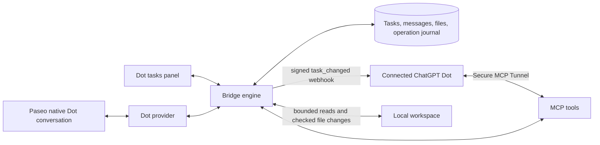

# Paseo Dot Bridge

Chat with your connected ChatGPT **Dot** in Paseo and apply requested code changes directly to the **local workspace**. Text, progress, files and code edits travel through MCP. Git delivery has been removed.

Plugin ID: `paseo-dot-bridge`. Select **Dot → Connected Dot** in a normal Paseo conversation, or create a request in **Dot tasks**. Both use the same durable task engine. There is no repository, remote, branch or commit setup.

## Conversation and local code changes

- Dot reads the latest task and prior rounds, claims the current round, and replies through the Bridge. Longer work starts with a short acknowledgment and useful progress messages in the chat. The complete answer finishes the turn. Delivery is incremental messages, not token streaming.
- Native conversations show Bridge activity as Dot's calls finish: reading your message, listing directories, reading files/attachments, file-edit diffs and chunked attachment progress. Progress updates reuse one card; file conflicts and refused calls show failures. The provider checks for updates every 750 ms. No new Dot tools or subscription instructions are needed for this display; reload the updated plugin to enable it.
- A code request uses `list_dot_files`, `read_dot_file` and `apply_dot_changes`. These operate on the workspace bound by Paseo, including uncommitted files. A code example or attached file alone does not change the workspace.
- Before replacing or deleting a file, Dot reads its current SHA-256. Every change includes that expected hash; a new file uses `null` and is created only if absent. The latest user-message sequence must also match. Known conflicts are rejected before the batch starts, and each file is checked again immediately before mutation.
- Changes apply automatically within the user's request. The returned receipt lists exactly which files were created, updated or deleted. The chat and task panel show the outcome. New permissions and unrelated or destructive actions still require asking the user.
- Files are UTF-8 text, at most **256 KiB each**; a call contains **1–32 files**, up to **1 MiB** of replacement content. Full file contents are submitted, rather than a Git patch. Directory listing is paginated in groups of 200. Binary files still use attachments rather than local edits.
- Relative paths only. Parent traversal, symlinks below the workspace, hardlinked files, Git internals and common credential paths are refused. File modes and untouched files are preserved. No shell commands or local tests are executed by these tools.

The original contents and exact outcome are retained in a private durable operation journal. Replaying the same operation and payload returns its original receipt, even if a user edits a file afterward; changed-content replays are rejected. A crash during a batch does not cause remaining files to be blindly written on retry. An unexpected mid-batch failure reports `partial` with the applied subset; it is not reported as a successful full change. There is no automatic rollback or one-click undo in this version.

The Bridge serializes its own writes. It cannot lock every external editor or process: the final filesystem check and rename/unlink are not an OS-level multi-file transaction. Avoid concurrently editing the same file while Dot applies a change. Routine stale-content conflicts are detected; failures and interrupted operations remain visible with backups in the journal.

Activity shows operations that pass through the Bridge. Dot's own text still arrives through progress/final-answer calls. Read/list/upload activity keeps the latest 200 cards per task in the plugin process; a process restart does not replay that transient history. Edit cards replay from durable receipts and the original change journal, even after later user edits. Large rewrites or missing/invalid journals show the file path without a diff. See [activity feed validation](docs/activity-feed-validation.md) for coverage and limits.

## Architecture



The plugin registers the provider in Paseo; it does not run a Dot CLI or forward arbitrary workspace tools. One conversation maps to one task. Follow-ups open another round after completion; answers to Dot's questions continue the current round. Persistence replays messages, results and files and reattaches to active work without dispatching another task. Closing a conversation detaches the local view. Stop requests block further local file operations and ask the remote Dot to stop; they do not undo files already applied.

## Setup

```bash
paseo plugin add git:lalaze/paseo-plugins --path dot-bridge
```

This Git URL is an **installation source**, not a task delivery channel. `install-all.sh` and `update-all.sh` do not install or update this plugin.

1. Enable the plugin on the host. In **Settings → Dot Bridge**, configure the listening address/port and in-flight cap (1 or 2).
2. In **Dot tasks → Connection**, configure the connection name and public tunnel base. Use a Secure MCP Tunnel to the plugin's separate `/mcp/dot` server, not Paseo's `/mcp/agents` endpoint.
3. Connect the custom plugin in ChatGPT and copy the current connection instructions to Dot. It must subscribe to `paseo.dot.task_changed` and `paseo.dot.connection_test`, using the platform callback and signing secret.
4. Run the two-way connection test. Dispatch waits for the local service, verified event route and successful Dot challenge response.
5. After upgrading, refresh the connected plugin's tools in ChatGPT. The old `submit_dot_result` is removed; the local file tools and attachment chunk tools must be visible. Update existing subscription instructions to use local edits, not cloud Git delivery. Only requests from the selected workspace authorize relevant file changes; new permissions still require confirmation.

A subscription originally limited to observing a connection test can receive events without executing them. Its task-handling instructions must permit processing the user's requests. The user's existing connection was previously enabled for native conversations; the current local-edit validation record states whether the upgraded tools and rules have been verified live.

## Attachments

Dot returns files directly through the Bridge, without asking the user to open ChatGPT Library or download an attachment there. Each delivered file is automatically saved on the **Paseo host** as `files/<taskId>/<operationId>/<name>` in the plugin data directory, with a path shown in the conversation. Files are separate from the project and never overwrite another operation's file. Saving on the host does not copy the file to a remote phone.

`upload_dot_attachment` still handles files up to **1 MiB**. Larger files use `upload_dot_attachment_chunk`: **20 MiB per file, 16 attachments per conversation**, 393216 raw bytes per chunk (the final chunk may be smaller). All chunks share an operation UUID, filename, MIME type, total size and full-file SHA-256. Each chunk is Base64 encoded; this is chunked MCP transport, not an unauthenticated HTTPS download URL. The response lists received indices; the last required chunk verifies the complete file and returns `complete: true` with the saved attachment. Exact retries and out-of-order delivery work across process restarts. Changed manifests/bytes, stale rounds, unclaimed tasks and stop requests are rejected. Incomplete transfers are bounded to 16 per task; expired transfers are cleaned when that task next uploads after 24 hours. Completed blobs and delivered files are retained without automatic pruning.

Use `read_dot_attachment_chunk` to read larger files. PNG/JPEG/WebP/GIF attachments preview in the conversation; images up to 8 MiB load automatically, larger ones have a preview button to bound memory use. SVG/HTML attachments are never rendered as active content. The web client can save another copy; native clients can copy the host path or small UTF-8 attachments. User-initiated uploads remain limited to 1 MiB. Existing attachments remain readable; only newly delivered Dot files receive named local copies.

## Persistence and compatibility

Data lives in `PASEO_DOT_BRIDGE_DATA_DIR`, or `$PASEO_HOME/paseo-dot-bridge`; startup refuses to guess a fallback. State, private credentials and SHA-addressed attachments remain separate. `local-changes/<operationId>.json` holds original file contents, change intent and the durable receipt with mode 0600. Back up this directory with the state and attachments. Journals currently have no automatic pruning and may contain source code.

Store **v8** adds larger attachment metadata and local delivery paths; v7 added the pinned workspace root and local code-change receipts. Older files are migrated with their original bytes backed up as `state.v<version>.json`. Older native conversations gain their local binding on the next message through Paseo. Older panel-only text tasks without a local binding should be recreated to edit files. Settings v3 removes repository, branch and cloud-environment defaults.

Historical Git tasks and verified results remain readable. The installed plugin has no Git adapter, does not dispatch/claim/continue those tasks, and exposes no Git result-submission or re-verification tool. Historical state schemas and compatibility tests are retained so upgrading does not erase prior deliveries. No Git fetch, commit, push, PR or merge is part of current task execution.

## Validation and current limits

Run `npm run check` for typecheck, tests and bundles. HTTP tests need permission to bind local test ports.

Local file coverage includes real filesystem creation/update/deletion, stale hashes, original-content journals, unchanged user edits, path traversal, symlinks, hardlinks, UTF-8 bounds, duplicate calls, interrupted batches, failed state writes after file application, authorization/round/stop checks, and authenticated MCP reads/writes. Historical engine, persistence, callback and attachment tests remain in the suite.

See [activity feed validation](docs/activity-feed-validation.md), [automatic file delivery validation](docs/automatic-files-validation.md) and [local code delivery validation](docs/local-delivery-validation.md). Earlier [provider](docs/provider-validation.md), [text/attachment](docs/text-attachments-validation.md) and [Git delivery](docs/phase-0-validation.md) records describe the versions tested at those times.

Current limits: one host and connected Dot; no token streaming, model switching, usage accounting, arbitrary shell execution, injected MCP tools, automatic local tests, binary saving to a remote phone or rewind. Cloud wake-up and long remote tool calls can delay progress. The web client has been exercised; native mobile and desktop UI automation remain unverified.
